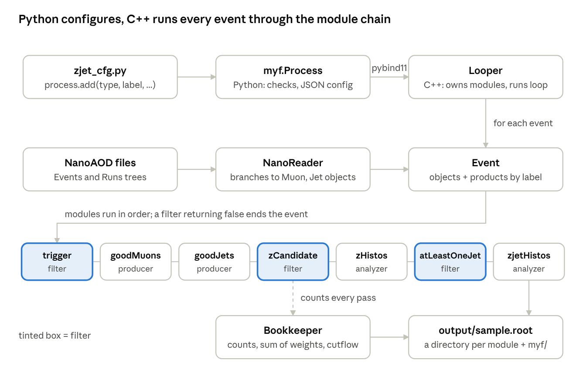

# Build Your Own HEP Framework: a Z+jet Tutorial

*Companion tutorial of this repository: the framework it builds, step by step, is the code you find here.*

In about 6 hours you build **myf** ("Make Your Framework"): a small, modular C++ analysis framework steered from Python. It ends in a Z(→μμ)+jet selection on CMS open data and a data vs MC plot of the dimuon mass peak.

## What you will build

The physics is deliberately simple; the point is the code. You will learn how to:

- design a **data model** (muons, jets, a Z candidate) instead of juggling flat arrays,
- split an analysis into small, reusable **modules** that talk to each other only through the event,
- keep **book-keeping** (events read, sums of weights, cutflows, provenance) so every output file can be normalised and trusted later,
- build a **C++ library** and drive it from a **Python** configuration, the way large experiment frameworks do.

You only need basic C++ and Python (variables, loops, `if`, functions). Every new concept (classes, inheritance, virtual functions, templates, smart pointers, Python bindings) gets a short *Concept* box at the point where we first need it, with an example from our own code.

The finished code lives in the `MakeYourFramework/` directory. Each section builds one piece of it, so you can either type along or read the file and compare.

## Roadmap

| Section | You learn | Time |
| --- | --- | --- |
| 0. Setup | environment on lxplus or locally, CMake, project layout | 20 min |
| 1. A first look at NanoAOD | TTree branches, a 30-line event loop, why it does not scale | 30 min |
| 2. The data model | classes, inheritance, the `Event` and its products | 45 min |
| 3. Modules | virtual functions, a base class, configuration, a factory | 60 min |
| 4. The event loop | the reader, the looper, ownership with smart pointers | 45 min |
| 5. Book-keeping | sums of weights, cutflows, provenance, luminosity sections | 40 min |
| 6. Talking to Python | pybind11, a Python package, configuration files | 45 min |
| 7. Data vs MC | running, normalising, plotting the Z peak | 30 min |
| 8. Good practices and next steps | a checklist and exercises | 15 min |

> Tip: each section ends with a **Checkpoint**: something you can run to verify that what you built works before moving on.

## 0. Setup (20 min)

You need ROOT, a C++17 compiler, CMake, Python 3 with pybind11, and for plotting uproot, matplotlib and mplhep. Pick one of the two routes below; everything after this section is identical.

| Package | Why we need it | Minimum version |
| --- | --- | --- |
| ROOT | reading NanoAOD (`TTreeReader`), histograms, Lorentz vectors | 6.26 |
| C++ compiler (gcc or clang) | builds the framework | C++17 support (gcc ≥ 9) |
| CMake + make | builds the library and the Python module | 3.16 |
| Python 3 | configuration and steering | 3.9 |
| pybind11 | exposes C++ classes to Python | 2.10 |
| uproot, numpy, matplotlib, mplhep | reading histograms and plotting in Python | recent |
| xrootd client (comes with ROOT) | reading the open data files over the network | – |

### Route A: lxplus (or any machine with /cvmfs)

Everything is in an LCG software view; `setup.sh` sources it for you.

```bash
ssh <user>@lxplus.cern.ch
cd MakeYourFramework
source setup.sh        # LCG_108: ROOT 6.36, gcc 13, python 3.12, pybind11, uproot, mplhep
```

### Route B: your own laptop (Linux or macOS)

Install [Miniforge](https://github.com/conda-forge/miniforge) (a minimal conda), then create the environment from `environment.yml` in the repository. ROOT from conda-forge includes the xrootd client, so you can still read the CMS open data over the network without any CERN account.

```yaml
# environment.yml
name: myf
channels:
  - conda-forge
dependencies:
  - python=3.12
  - root>=6.30
  - cmake>=3.16
  - make
  - cxx-compiler
  - pybind11
  - uproot
  - mplhep
  - matplotlib
  - numpy
```

```bash
conda env create -f environment.yml     # once, takes a few minutes
conda activate myf
source setup.sh                         # sees $CONDA_PREFIX and skips /cvmfs
```

The input files are public CMS open data and are read directly from `root://eospublic.cern.ch` with no account. If you want to work offline, `myf-download` (Section 7) copies them, about 1.1 GB in total.

`setup.sh` itself is short: it picks the environment, then puts our Python package and scripts on the paths.

```bash
# setup.sh
MYF_LCG_VIEW=/cvmfs/sft.cern.ch/lcg/views/LCG_108/x86_64-el9-gcc13-opt
if [ -z "$CONDA_PREFIX" ] && [ -f "$MYF_LCG_VIEW/setup.sh" ]; then
  source "$MYF_LCG_VIEW/setup.sh"
fi
export MYF_BASE="$(cd "$(dirname "${BASH_SOURCE[0]}")" && pwd)"
export PYTHONPATH="$MYF_BASE/python:$PYTHONPATH"
export PATH="$MYF_BASE/scripts:$PATH"
```

### Project layout

Good frameworks separate *what the data is* from *what we do with it* and from *how we steer it*. Our layout mirrors that:

```text
MakeYourFramework/
├── DataFormats/include/myf/   the data model: Particle, Lepton, Muon, Jet, ZCandidate
├── Core/include/myf/          framework classes: Event, Module, ParameterSet, ModuleFactory,
│   Core/src/                  NanoReader, Bookkeeper, Looper
├── Modules/                   analysis steps, one file each (MuonSelector.cc, ZBuilder.cc, ...)
├── bindings/PyMyf.cc          the C++ -> Python bridge
├── python/myf/                the Python package: Process, load_samples
├── configs/zjet_cfg.py        our analysis, as a configuration
├── samples/samples.json       which files, data or MC, cross sections
├── scripts/                   myf-run, myf-download, plot_zmass.py
├── examples/first_loop.C      Section 1
├── CMakeLists.txt, setup.sh, environment.yml
```

> **Concept: libraries and CMake.** A *shared library* (`libmyf.so`) is compiled code that other programs load at run time. We put the whole framework in one library, and a small second library (`_myf.so`) that Python can import. CMake is a tool that writes the build instructions for you: you list the sources, the libraries they need (ROOT, pybind11) and where the headers are, and it works out the compiler commands.

```cmake
# CMakeLists.txt
cmake_minimum_required(VERSION 3.16)
project(MakeYourFramework CXX)

set(CMAKE_CXX_STANDARD 17)
set(CMAKE_CXX_STANDARD_REQUIRED ON)
if(NOT CMAKE_BUILD_TYPE)
  set(CMAKE_BUILD_TYPE RelWithDebInfo)
endif()

find_package(ROOT REQUIRED COMPONENTS Tree Hist RIO MathCore)
find_package(Python COMPONENTS Interpreter Development.Module REQUIRED)
execute_process(COMMAND ${Python_EXECUTABLE} -m pybind11 --cmakedir
                OUTPUT_VARIABLE pybind11_DIR OUTPUT_STRIP_TRAILING_WHITESPACE)
find_package(pybind11 CONFIG REQUIRED)

# libmyf: data formats (header only), core and modules
file(GLOB CORE_SOURCES Core/src/*.cc)
file(GLOB MODULE_SOURCES Modules/*.cc)
add_library(myf SHARED ${CORE_SOURCES} ${MODULE_SOURCES})
target_include_directories(myf PUBLIC DataFormats/include Core/include)
target_link_libraries(myf PUBLIC ROOT::Tree ROOT::TreePlayer ROOT::Hist ROOT::RIO ROOT::MathCore)
target_compile_options(myf PRIVATE -Wall -Wextra)

# the python module, written next to the python package so that "import myf" finds it
pybind11_add_module(_myf bindings/PyMyf.cc)
target_link_libraries(_myf PRIVATE myf)
set_target_properties(_myf PROPERTIES LIBRARY_OUTPUT_DIRECTORY ${PROJECT_SOURCE_DIR}/python/myf)
```

The build always happens in a separate `build/` directory, so the sources stay clean:

```bash
mkdir -p build && cd build && cmake .. && make -j8 && cd ..
```

**Checkpoint.** `root-config --version` prints a version, and `python3 -c "import pybind11, uproot, mplhep"` prints nothing. (The build itself will only succeed once the code exists; we write it in Sections 2 to 6.)

## 1. A first look at NanoAOD (30 min)

A 30-line ROOT macro already finds about 2000 dimuon candidates in one data file. This section writes that macro, then lists what goes wrong when it grows into a real analysis.

### The samples

We use two CMS 2016 NanoAOD (v9) samples from the [CERN Open Data portal](https://opendata.cern.ch):

| Sample | Type | Files | Events | Notes |
| --- | --- | --- | --- | --- |
| `SingleMuon_2016H` | data | 3 | 438 793 | events that fired a single-muon trigger |
| `DYJetsToLL_M50_amcatnlo` | MC | 1 | 587 515 | Z/γ\* → ℓℓ, m > 50 GeV, NLO generator with negative weights |

### What is in a NanoAOD file

A NanoAOD file holds a `TTree` called `Events`: one entry per collision, and *flat* branches. A collection like the muons is stored as a counter plus one array per property:

```text
nMuon          UInt_t        number of muons in this event
Muon_pt        Float_t[nMuon]
Muon_eta       Float_t[nMuon]
Muon_charge    Int_t[nMuon]
Muon_tightId   Bool_t[nMuon]
...
HLT_IsoMu24    Bool_t        did this trigger fire?
genWeight      Float_t       MC only: the generator weight
```

So "the second muon" is not an object; it is index 1 in a dozen separate arrays. Look for yourself:

```bash
root -l root://eospublic.cern.ch//eos/opendata/cms/Run2016H/SingleMuon/NANOAOD/UL2016_MiniAODv2_NanoAODv9-v1/120000/61FC1E38-F75C-6B44-AD19-A9894155874E.root
root [1] Events->Print("Muon_*")
root [2] Events->Scan("nMuon:Muon_pt:Muon_charge", "", "", 5)
```

There is also a small `Runs` tree with one entry per run. In MC it holds `genEventSumw`, the sum of generator weights of **all** produced events. We will need it in Section 5.

### Your first event loop

`TTreeReader` reads a tree entry by entry; `TTreeReaderArray` gives access to one array branch.

```cpp
// examples/first_loop.C: the dimuon mass in 30 lines, no framework.
// Run with:  root -l -b -q examples/first_loop.C
#include <iostream>

#include <TFile.h>
#include <TH1D.h>
#include <TTreeReader.h>
#include <TTreeReaderArray.h>
#include <Math/Vector4D.h>

void first_loop() {
  auto* file = TFile::Open("root://eospublic.cern.ch//eos/opendata/cms/Run2016H/SingleMuon/NANOAOD/"
                           "UL2016_MiniAODv2_NanoAODv9-v1/120000/61FC1E38-F75C-6B44-AD19-A9894155874E.root");
  TTreeReader reader("Events", file);
  TTreeReaderArray<Float_t> pt(reader, "Muon_pt"), eta(reader, "Muon_eta"), phi(reader, "Muon_phi"),
      mass(reader, "Muon_mass");
  TTreeReaderArray<Int_t> charge(reader, "Muon_charge");

  TH1D h("mass", ";m_{#mu#mu} [GeV];Events", 60, 60, 120);
  while (reader.Next()) {
    if (pt.GetSize() < 2) continue;                 // need two muons
    if (charge[0] * charge[1] > 0) continue;        // of opposite charge
    ROOT::Math::PtEtaPhiMVector mu1(pt[0], eta[0], phi[0], mass[0]);
    ROOT::Math::PtEtaPhiMVector mu2(pt[1], eta[1], phi[1], mass[1]);
    h.Fill((mu1 + mu2).M());
  }
  std::cout << "dimuon candidates: " << h.GetEntries() << std::endl;
  h.SaveAs("first_loop_mass.root");
}
```

**Checkpoint.** `root -l -b -q examples/first_loop.C` prints `dimuon candidates: 1998`. Open `first_loop_mass.root` and draw the histogram: there is the Z.

### Why not stop here?

Now imagine the real analysis: add ID and isolation cuts, jets cleaned against the muons, a trigger, MC weights, ten more histograms, a second selection region, a dozen MC samples, a cutflow for the analysis note. In one macro, this becomes a 2000-line `main()` where:

- the same cut is copy-pasted in three places, and one copy is forgotten when it changes,
- `pt[i]` from the muon arrays is mixed up with `pt[i]` from the jet arrays,
- nobody knows which cuts produced last month's plot,
- the MC normalisation is a number typed into the plotting script.

The framework fixes these with five rules we follow for the rest of the tutorial:

1. **Objects, not arrays.** Branches are turned into `Muon` and `Jet` objects in exactly one place.
2. **One job per module.** Each step (select muons, build the Z, fill histograms) is a small class you can reuse and test alone.
3. **Modules talk through the event.** A module puts its result in the event under a label; later modules get it by that label. No module knows about another.
4. **Configuration is separate from code.** Cut values live in a Python config, not in the C++.
5. **Every output file explains itself.** It records what was read, what passed, which config and which files produced it.

## 2. The data model (45 min)

The data model is the set of types your analysis speaks: `Muon`, `Jet`, `ZCandidate`, and the `Event` that holds them. Get it right and the rest of the code reads like physics.

> **Concept: classes and structs.** A `struct` (or `class`) groups related data into one new type. The variables inside are *members*; functions inside are *methods* and can use the members directly. `struct` and `class` are the same thing in C++, except that members are public by default in a `struct` and private in a `class`. We use `struct` for plain data and `class` when we want to hide the internals.
>
> ```cpp
> struct Particle {
>   float pt = 0;              // members, with default values
>   float eta = 0;
>   LorentzVector p4() const;  // a method; const = it does not change the particle
> };
> Particle p;  p.pt = 35.2;    // an object (instance) of type Particle
> ```

### Particle: what every object has

```cpp
// DataFormats/include/myf/Particle.h
#pragma once
// Particle: the common base of every physics object (muons, jets, ...).
#include <Math/Vector4D.h>
#include <Math/VectorUtil.h>
#include <cmath>

namespace myf {

using LorentzVector = ROOT::Math::PtEtaPhiMVector;

struct Particle {
  float pt = 0;
  float eta = 0;
  float phi = 0;
  float mass = 0;

  LorentzVector p4() const { return LorentzVector(pt, eta, phi, mass); }
};

inline float deltaPhi(float phi1, float phi2) {
  float dphi = phi1 - phi2;
  while (dphi > M_PI) dphi -= 2 * M_PI;
  while (dphi <= -M_PI) dphi += 2 * M_PI;
  return dphi;
}

inline float deltaR(const Particle& a, const Particle& b) {
  float deta = a.eta - b.eta;
  float dphi = deltaPhi(a.phi, b.phi);
  return std::sqrt(deta * deta + dphi * dphi);
}

}  // namespace myf
```

Three small habits are already visible here. `#pragma once` stops a header from being included twice. Everything lives in `namespace myf`, so our `Event` cannot clash with someone else's. And `deltaR` takes `const Particle&`, a *reference*: the function looks at the original object instead of copying it, and `const` promises not to change it.

> **Concept: inheritance ("is a").** A muon *is a* lepton, and a lepton *is a* particle. With `struct Muon : public Lepton`, a `Muon` gets every member of `Lepton` (and therefore of `Particle`) for free and adds its own. Code written for a `Particle`, like `deltaR`, then works on muons and jets alike.

### Lepton, Muon, Jet

```cpp
// DataFormats/include/myf/Lepton.h
#pragma once
// Lepton: what muons and electrons have in common.
#include "myf/Particle.h"

namespace myf {

struct Lepton : public Particle {
  int charge = 0;
  float relIso = 0;  // relative PF isolation (dR < 0.4 for muons)
};

}  // namespace myf
```

```cpp
// DataFormats/include/myf/Muon.h
#pragma once
#include "myf/Lepton.h"

namespace myf {

struct Muon : public Lepton {
  bool tightId = false;
  bool mediumId = false;
};

}  // namespace myf
```

```cpp
// DataFormats/include/myf/Jet.h
#pragma once
#include "myf/Particle.h"

namespace myf {

struct Jet : public Particle {
  int jetId = 0;     // NanoAOD bit field: bit 1 = tight, bit 2 = tight + lepton veto
  float btag = 0;    // DeepJet b-tag score

  bool passesTightId() const { return jetId & 2; }
};

}  // namespace myf
```

Note `passesTightId()`: the meaning of the bit field is written down once, next to the data, instead of `jetId & 2` scattered through the analysis.

The `Lepton` level looks unnecessary with only muons, but it is where an `Electron` will slot in (an exercise in Section 8). Code that only needs charge and isolation can then accept any `Lepton`.

### ZCandidate: a derived object

Not all objects come from the file. The Z candidate is built by our analysis, and it gets a type too:

```cpp
// DataFormats/include/myf/ZCandidate.h
#pragma once
// ZCandidate: a pair of opposite-charge muons, the leading one first.
#include "myf/Muon.h"

namespace myf {

struct ZCandidate {
  Muon mu1;
  Muon mu2;
  LorentzVector p4;

  double mass() const { return p4.M(); }
  double pt() const { return p4.Pt(); }
};

}  // namespace myf
```

`ZCandidate` is *not* a `Particle`: it *has* two muons. Choosing between "is a" (inheritance) and "has a" (a member) is one of the main design decisions in any data model. When in doubt, prefer "has a".

### The Event and its products

The `Event` holds the raw objects read from the file (filled by the reader in Section 4) and a store of **products**: things modules compute and hand to later modules, such as the selected muons. Products are stored and retrieved by a string label.

> **Concept: templates and std::any.** A *template* is a function written once for any type `T`: `put<T>` stores a `std::vector<Muon>` as easily as a `ZCandidate`. `std::any` is a box that can hold a value of any type; `std::any_cast<T>` opens it and checks that it really holds a `T`. Together they let one `Event` carry products whose types the framework has never heard of, while still catching mistakes like asking for jets under a muon label.

```cpp
// Core/include/myf/Event.h
#pragma once
// Event: everything we know about one collision.
// The reader fills the raw objects; modules add "products" (selected muons, a Z candidate, ...)
// with put() and later modules read them back with get(), by label.
#include <any>
#include <map>
#include <stdexcept>
#include <string>
#include <vector>

#include "myf/Jet.h"
#include "myf/Muon.h"

namespace myf {

class Event {
 public:
  // raw content, filled by the NanoReader
  unsigned run = 0;
  unsigned lumi = 0;
  unsigned long long number = 0;
  bool isData = false;
  double weight = 1.0;  // generator weight for MC, 1 for data
  std::vector<Muon> muons;
  std::vector<Jet> jets;
  std::map<std::string, bool> triggers;

  template <typename T>
  void put(const std::string& label, T product) {
    if (has(label)) throw std::runtime_error("[myf] product '" + label + "' already exists");
    products_[label] = std::move(product);
  }

  template <typename T>
  const T& get(const std::string& label) const {
    auto it = products_.find(label);
    if (it == products_.end()) throw std::runtime_error("[myf] no product '" + label + "' in the event");
    if (const T* product = std::any_cast<T>(&it->second)) return *product;
    throw std::runtime_error("[myf] product '" + label + "' has a different type");
  }

  bool has(const std::string& label) const { return products_.count(label) > 0; }

  void clear() {
    muons.clear();
    jets.clear();
    triggers.clear();
    products_.clear();
  }

 private:
  std::map<std::string, std::any> products_;
};

}  // namespace myf
```

Two design choices worth copying:

- **Products are read-only.** `get` returns a `const T&`. A module can read another module's muons but cannot secretly change them, so the result of a module never depends on who ran after it.
- **Errors are loud and specific.** A typo in a label throws `no product 'goodMuon' in the event` at the first event, instead of silently producing an empty plot.

**Checkpoint.** In a scratch `.cc` file, include `myf/Event.h`, create two muons, `put` them under `"goodMuons"`, `get` them back and print `deltaR` between them. Then ask for `event.get<std::vector<Jet>>("goodMuons")` and read the error message. Compile it with \`g++ -std=c++17 -IDataFormats/include -ICore/include test.cc $(root-config --cflags --libs)\`.

## 3. Modules (60 min)

Every step of the analysis is a *module*: a small class with one job. All modules share one base class, so the framework can run any list of them without knowing what they do.

> **Concept: virtual functions and polymorphism.** A base class can declare a method `virtual`, which means "each derived class may provide its own version". Marking it `= 0` (*pure virtual*) means "each derived class must". When the framework holds a list of `Module*` and calls `module->process(event)`, C++ looks up at run time which kind of module it really is and calls *that* version. This is polymorphism: one interface, many behaviours. In the derived class, write `override` so the compiler checks that you really replaced a base method (a typo then becomes a compile error, not a silently ignored function).
>
> ```cpp
> struct Shape { virtual double area() const = 0; virtual ~Shape() = default; };
> struct Square : Shape { double a; double area() const override { return a * a; } };
> ```
>
> A base class with virtual methods must also have a `virtual` destructor, so that deleting a `Square` through a `Shape*` cleans up the whole `Square`.

### The Module base class

```cpp
// Core/include/myf/Module.h
#pragma once
// Module: the base class of every step of the analysis.
// process() returns false to stop the event (a filter); producers and analyzers return true.
#include <string>

#include "myf/Event.h"
#include "myf/JobContext.h"
#include "myf/ParameterSet.h"

namespace myf {

class Module {
 public:
  Module(const std::string& label, const ParameterSet& params) : label_(label), params_(params) {}
  virtual ~Module() = default;

  virtual void beginJob(JobContext&) {}
  virtual bool process(Event& event) = 0;
  virtual void endJob() {}

  const std::string& label() const { return label_; }

 protected:
  const ParameterSet& params() const { return params_; }

 private:
  std::string label_;
  ParameterSet params_;
};

}  // namespace myf
```

A module's life has three moments: `beginJob` once before the loop (book histograms, ask for branches), `process` for every event, `endJob` once at the end. Only `process` is mandatory.

The return value of `process` gives us three kinds of module with one interface:

| Kind | Does | Returns | Our examples |
| --- | --- | --- | --- |
| Producer | computes something and `put`s it in the event | always `true` | `MuonSelector`, `JetSelector` |
| Filter | decides if the event goes on | `true` or `false` | `TriggerFilter`, `ZBuilder`, `CountFilter` |
| Analyzer | fills histograms | always `true` | `ZJetHistos` |

Every module also has a **label**, its name in this particular analysis, used to name its product and its histogram directory. The *type* says what the module is (`MuonSelector`); the *label* says which instance it is (`goodMuons`). The same type can appear twice with different labels and parameters.

### Configuration: ParameterSet

Modules never hard-code cut values. They read them from a `ParameterSet`, which Python fills (Section 6).

> **Concept: std::variant.** A `std::variant<double, std::string>` holds *either* a number *or* a string, and remembers which. `std::get_if<double>(&v)` returns a pointer to the number if that is what is inside, otherwise `nullptr`. We use it so one parameter map can hold numbers, strings and lists of strings.

```cpp
// Core/include/myf/ParameterSet.h
#pragma once
// ParameterSet: the configuration of one module, filled from python.
#include <map>
#include <stdexcept>
#include <string>
#include <variant>
#include <vector>

namespace myf {

class ParameterSet {
 public:
  using Value = std::variant<double, std::string, std::vector<std::string>>;

  ParameterSet() = default;
  explicit ParameterSet(std::map<std::string, Value> values) : values_(std::move(values)) {}

  bool has(const std::string& name) const { return values_.count(name) > 0; }

  double getDouble(const std::string& name) const { return get<double>(name); }
  double getDouble(const std::string& name, double fallback) const {
    return has(name) ? getDouble(name) : fallback;
  }
  int getInt(const std::string& name, int fallback) const {
    return has(name) ? static_cast<int>(getDouble(name)) : fallback;
  }
  bool getBool(const std::string& name, bool fallback) const {
    return has(name) ? getDouble(name) != 0 : fallback;
  }
  const std::string& getString(const std::string& name) const { return get<std::string>(name); }
  std::string getString(const std::string& name, const std::string& fallback) const {
    return has(name) ? getString(name) : fallback;
  }
  const std::vector<std::string>& getStrings(const std::string& name) const {
    return get<std::vector<std::string>>(name);
  }

 private:
  template <typename T>
  const T& get(const std::string& name) const {
    auto it = values_.find(name);
    if (it == values_.end()) throw std::runtime_error("[myf] missing parameter '" + name + "'");
    if (const T* value = std::get_if<T>(&it->second)) return *value;
    throw std::runtime_error("[myf] parameter '" + name + "' has the wrong type");
  }

  std::map<std::string, Value> values_;
};

}  // namespace myf
```

Getters without a fallback make a parameter **required**: forget `ptMin` in the config and the job stops with `missing parameter 'ptMin'` before reading a single event. Use fallbacks only for values with an obvious default.

### What a module may use at the start: JobContext

In `beginJob` a module gets a `JobContext`: the sample (data or MC?), a helper to book histograms in its own directory of the output file, and a way to ask the reader for extra branches. Giving modules a narrow context, instead of the whole framework, keeps them independent.

```cpp
// Core/include/myf/JobContext.h
#pragma once
// JobContext: what a module may use in beginJob(): the sample, its own histogram
// directory, and the reader (to ask for extra branches such as trigger bits).
#include <TDirectory.h>
#include <TH1D.h>

#include <string>

#include "myf/NanoReader.h"
#include "myf/Sample.h"

namespace myf {

class JobContext {
 public:
  JobContext(const Sample& sample, TDirectory* dir, NanoReader& reader)
      : sample_(sample), dir_(dir), reader_(reader) {}

  const Sample& sample() const { return sample_; }
  bool isData() const { return sample_.isData; }

  // the histogram lives in this module's directory of the output file, which owns it
  TH1D* book1D(const std::string& name, const std::string& title, int nbins, double lo, double hi) {
    dir_->cd();
    auto* h = new TH1D(name.c_str(), title.c_str(), nbins, lo, hi);
    h->Sumw2();
    return h;
  }

  void requestTrigger(const std::string& path) { reader_.addTrigger(path); }

 private:
  const Sample& sample_;
  TDirectory* dir_;
  NanoReader& reader_;
};

}  // namespace myf
```

`Sample` is a plain struct (name, `isData`, cross section, list of files) in `Core/include/myf/Sample.h`; `NanoReader` comes in Section 4.

### Your first module: MuonSelector

```cpp
// Modules/MuonSelector.cc
// MuonSelector: muons passing kinematic, identification and isolation cuts, sorted by pt.
// python: process.add("MuonSelector", "goodMuons", ptMin=20, etaMax=2.4, id="tight", isoMax=0.15)
#include <algorithm>
#include <cmath>

#include "myf/ModuleFactory.h"

namespace myf {

class MuonSelector : public Module {
 public:
  MuonSelector(const std::string& label, const ParameterSet& params)
      : Module(label, params),
        ptMin_(params.getDouble("ptMin")),
        etaMax_(params.getDouble("etaMax")),
        isoMax_(params.getDouble("isoMax")),
        id_(params.getString("id", "tight")) {
    if (id_ != "tight" && id_ != "medium") throw std::runtime_error("[myf] " + label + ": id must be tight or medium");
  }

  bool process(Event& event) override {
    std::vector<Muon> selected;
    for (const auto& mu : event.muons) {
      if (mu.pt < ptMin_ || std::abs(mu.eta) > etaMax_) continue;
      if (id_ == "tight" ? !mu.tightId : !mu.mediumId) continue;
      if (mu.relIso > isoMax_) continue;
      selected.push_back(mu);
    }
    // NanoAOD collections are already pt-ordered, sort anyway: the next modules rely on it
    std::sort(selected.begin(), selected.end(), [](const Muon& a, const Muon& b) { return a.pt > b.pt; });
    event.put(label(), selected);
    return true;
  }

 private:
  double ptMin_, etaMax_, isoMax_;
  std::string id_;
};

MYF_REGISTER_MODULE(MuonSelector, "muons passing pt, eta, ID and isolation cuts")

}  // namespace myf
```

Things to notice:

- Parameters are read **once**, in the constructor, into members, and checked there. `process` runs millions of times and should not search a map each time.
- The header comment shows the exact Python line that uses the module. It is the module's documentation, and it never goes out of date if you update it with the code.
- The product is stored under the module's **label**. Whoever wants these muons asks for `"goodMuons"`, whatever the config called them.
- The module does not know which modules come before or after it.

### Creating modules by name: the factory

Python will say `process.add("MuonSelector", ...)`, with a *string*. Something has to turn that string into a `MuonSelector` object. That is the job of a **factory**: a table from type name to a small function that creates the module.

> **Concept: std::unique\_ptr and lambdas.** `std::unique_ptr<Module>` is a pointer that *owns* the object it points to and deletes it automatically when it goes away: no `new` without `delete`, no leaks, and exactly one owner. `std::make_unique<T>(...)` creates one. A *lambda* `[](int x) { return 2 * x; }` is a function written inline, without a name, which can be stored in a variable or a map like any value.

```cpp
// Core/include/myf/ModuleFactory.h
#pragma once
// ModuleFactory: creates a module from its type name, so python can say "MuonSelector".
// Every module registers itself with MYF_REGISTER_MODULE(Type, "one line doc").
#include <functional>
#include <map>
#include <memory>
#include <string>

#include "myf/Module.h"

namespace myf {

class ModuleFactory {
 public:
  using Creator = std::function<std::unique_ptr<Module>(const std::string&, const ParameterSet&)>;

  static ModuleFactory& instance();

  bool add(const std::string& type, Creator creator, const std::string& doc);
  std::unique_ptr<Module> create(const std::string& type, const std::string& label,
                                 const ParameterSet& params) const;
  std::map<std::string, std::string> available() const;  // type -> doc

 private:
  ModuleFactory() = default;
  std::map<std::string, Creator> creators_;
  std::map<std::string, std::string> docs_;
};

}  // namespace myf

#define MYF_REGISTER_MODULE(TYPE, DOC)                                                       \
  namespace {                                                                                \
  const bool registered_##TYPE = ::myf::ModuleFactory::instance().add(                       \
      #TYPE,                                                                                 \
      [](const std::string& label, const ::myf::ParameterSet& params) {                      \
        return std::unique_ptr<::myf::Module>(std::make_unique<TYPE>(label, params));        \
      },                                                                                     \
      DOC);                                                                                  \
  }
```

```cpp
// Core/src/ModuleFactory.cc
#include "myf/ModuleFactory.h"

#include <stdexcept>

namespace myf {

ModuleFactory& ModuleFactory::instance() {
  static ModuleFactory factory;
  return factory;
}

bool ModuleFactory::add(const std::string& type, Creator creator, const std::string& doc) {
  if (creators_.count(type)) throw std::runtime_error("[myf] module type '" + type + "' registered twice");
  creators_[type] = std::move(creator);
  docs_[type] = doc;
  return true;
}

std::unique_ptr<Module> ModuleFactory::create(const std::string& type, const std::string& label,
                                              const ParameterSet& params) const {
  auto it = creators_.find(type);
  if (it == creators_.end()) throw std::runtime_error("[myf] unknown module type '" + type + "'");
  return it->second(label, params);
}

std::map<std::string, std::string> ModuleFactory::available() const { return docs_; }

}  // namespace myf
```

The trick is in the macro. `MYF_REGISTER_MODULE(MuonSelector, "...")` defines a global variable `registered_MuonSelector` whose initial value is the result of `add(...)`. Global variables are initialised when the library is loaded, before `main` or Python run any of our code. So simply *compiling a module into the library* registers it: adding a new module never means editing a central list. `instance()` uses a `static` local variable, which C++ creates on first use, so the factory always exists before the first module registers.

### The other modules

The remaining modules follow the same pattern. Read them in `Modules/`; the interesting lines are shown here.

**JetSelector** reads another module's product to remove jets that are really muons:

```cpp
  bool process(Event& event) override {
    const auto& muons = event.get<std::vector<Muon>>(muons_);   // muons_ = params.getString("muons")
    std::vector<Jet> selected;
    for (const auto& jet : event.jets) {
      if (jet.pt < ptMin_ || std::abs(jet.eta) > etaMax_ || !jet.passesTightId()) continue;
      bool overlaps = false;
      for (const auto& mu : muons)
        if (deltaR(jet, mu) < dRMin_) overlaps = true;
      if (!overlaps) selected.push_back(jet);
    }
    event.put(label(), selected);
    return true;
  }
```

The muon label is a *parameter*, not a hard-coded `"goodMuons"`. That way you could run two jet selections, cleaned against two different muon selections, without changing C++.

**ZBuilder** is a filter that also produces something:

```cpp
  bool process(Event& event) override {
    const auto& muons = event.get<std::vector<Muon>>(muons_);
    if (muons.size() < 2) return false;
    ZCandidate z{muons[0], muons[1], muons[0].p4() + muons[1].p4()};
    if (z.mu1.pt < leadPtMin_) return false;
    if (z.mu1.charge * z.mu2.charge >= 0) return false;
    if (z.mass() < massMin_ || z.mass() > massMax_) return false;
    event.put(label(), z);
    return true;
  }
```

**TriggerFilter** shows `beginJob`: it asks the reader for the trigger branches it needs, so the reader never has to know about triggers in advance.

```cpp
  void beginJob(JobContext& job) override {
    for (const auto& path : paths_) job.requestTrigger(path);
  }

  bool process(Event& event) override {
    for (const auto& path : paths_)
      if (event.triggers.at(path)) return true;
    return false;
  }
```

**CountFilter** keeps events with between `min` and `max` objects in a jet collection: `return n >= min_ && n <= max_;`.

**ZJetHistos** is the analyzer. It books in `beginJob` and fills in `process`, always with the event weight:

```cpp
  void beginJob(JobContext& job) override {
    mass_ = job.book1D("mass", ";m_{#mu#mu} [GeV];Events", 60, 60, 120);
    zPt_ = job.book1D("zPt", ";p_{T}^{Z} [GeV];Events", 40, 0, 200);
    mu1Pt_ = job.book1D("mu1Pt", ";leading muon p_{T} [GeV];Events", 40, 0, 200);
    nJets_ = job.book1D("nJets", ";number of jets;Events", 6, -0.5, 5.5);
    jet1Pt_ = job.book1D("jet1Pt", ";leading jet p_{T} [GeV];Events", 40, 0, 400);
    dPhi_ = job.book1D("dPhiZJet", ";|#Delta#phi(Z, leading jet)|;Events", 32, 0, 3.2);
  }

  bool process(Event& event) override {
    const auto& z = event.get<ZCandidate>(z_);
    const auto& jets = event.get<std::vector<Jet>>(jets_);
    double w = event.weight;
    mass_->Fill(z.mass(), w);
    zPt_->Fill(z.pt(), w);
    mu1Pt_->Fill(z.mu1.pt, w);
    nJets_->Fill(jets.size(), w);
    if (!jets.empty()) {
      jet1Pt_->Fill(jets[0].pt, w);
      dPhi_->Fill(std::abs(deltaPhi(z.p4.Phi(), jets[0].phi)), w);
    }
    return true;
  }
```

Because histograms go into a directory named after the module's *label*, we can place the same `ZJetHistos` twice in the chain (`zHistos` after the Z, `zjetHistos` after requiring a jet) and get two sets of plots for free.

**Checkpoint.** You will be able to build and list the modules after Section 6: `python3 -c "import myf; print(myf.available_modules())"` prints all six types with their one-line docs.

## 4. The event loop (45 min)

Two classes turn the pieces into a running job: the `NanoReader` converts branches into objects, and the `Looper` owns the modules and runs them on every event.



Python builds the module list once; after that, everything per event happens in C++, and the output file collects the histograms and the book-keeping.

### NanoReader: the only place that knows branch names

If the input format changes (a new NanoAOD version renames a branch or changes its type), exactly one file changes. No module ever sees `Muon_pt`.

```cpp
// Core/include/myf/NanoReader.h
#pragma once
// NanoReader: the only place that knows NanoAOD branch names.
// It translates the flat branches (Muon_pt[i], Muon_eta[i], ...) into Event objects.
// Branch types are those of NanoAODv9 (Run 2 UL).
#include <TChain.h>
#include <TTreeReader.h>
#include <TTreeReaderArray.h>
#include <TTreeReaderValue.h>

#include <map>
#include <memory>
#include <string>

namespace myf {

class Event;

class NanoReader {
 public:
  NanoReader(TChain& chain, bool isData);

  void addTrigger(const std::string& path);
  bool next();  // move to the next entry, false at the end
  void fill(Event& event);

 private:
  TTreeReader reader_;
  bool isData_;

  TTreeReaderValue<UInt_t> run_{reader_, "run"};
  TTreeReaderValue<UInt_t> lumi_{reader_, "luminosityBlock"};
  TTreeReaderValue<ULong64_t> event_{reader_, "event"};
  std::unique_ptr<TTreeReaderValue<Float_t>> genWeight_;  // MC only

  TTreeReaderArray<Float_t> muonPt_{reader_, "Muon_pt"};
  TTreeReaderArray<Float_t> muonEta_{reader_, "Muon_eta"};
  TTreeReaderArray<Float_t> muonPhi_{reader_, "Muon_phi"};
  TTreeReaderArray<Float_t> muonMass_{reader_, "Muon_mass"};
  TTreeReaderArray<Int_t> muonCharge_{reader_, "Muon_charge"};
  TTreeReaderArray<Float_t> muonIso_{reader_, "Muon_pfRelIso04_all"};
  TTreeReaderArray<Bool_t> muonTightId_{reader_, "Muon_tightId"};
  TTreeReaderArray<Bool_t> muonMediumId_{reader_, "Muon_mediumId"};

  TTreeReaderArray<Float_t> jetPt_{reader_, "Jet_pt"};
  TTreeReaderArray<Float_t> jetEta_{reader_, "Jet_eta"};
  TTreeReaderArray<Float_t> jetPhi_{reader_, "Jet_phi"};
  TTreeReaderArray<Float_t> jetMass_{reader_, "Jet_mass"};
  TTreeReaderArray<Int_t> jetId_{reader_, "Jet_jetId"};
  TTreeReaderArray<Float_t> jetBtag_{reader_, "Jet_btagDeepFlavB"};

  std::map<std::string, std::unique_ptr<TTreeReaderValue<Bool_t>>> triggers_;
};

}  // namespace myf
```

```cpp
// Core/src/NanoReader.cc
#include "myf/NanoReader.h"

#include <stdexcept>

#include "myf/Event.h"

namespace myf {

NanoReader::NanoReader(TChain& chain, bool isData) : reader_(&chain), isData_(isData) {
  if (!isData_) genWeight_ = std::make_unique<TTreeReaderValue<Float_t>>(reader_, "genWeight");
}

void NanoReader::addTrigger(const std::string& path) {
  if (!triggers_.count(path)) triggers_[path] = std::make_unique<TTreeReaderValue<Bool_t>>(reader_, path.c_str());
}

bool NanoReader::next() {
  if (!reader_.Next()) {
    if (reader_.GetEntryStatus() != TTreeReader::kEntryBeyondEnd)
      throw std::runtime_error("[myf] error reading the input (missing or wrongly typed branch?)");
    return false;
  }
  return true;
}

void NanoReader::fill(Event& event) {
  event.run = *run_;
  event.lumi = *lumi_;
  event.number = *event_;
  event.isData = isData_;
  event.weight = isData_ ? 1.0 : **genWeight_;

  for (size_t i = 0; i < muonPt_.GetSize(); ++i) {
    Muon mu;
    mu.pt = muonPt_[i];
    mu.eta = muonEta_[i];
    mu.phi = muonPhi_[i];
    mu.mass = muonMass_[i];
    mu.charge = muonCharge_[i];
    mu.relIso = muonIso_[i];
    mu.tightId = muonTightId_[i];
    mu.mediumId = muonMediumId_[i];
    event.muons.push_back(mu);
  }

  for (size_t i = 0; i < jetPt_.GetSize(); ++i) {
    Jet jet;
    jet.pt = jetPt_[i];
    jet.eta = jetEta_[i];
    jet.phi = jetPhi_[i];
    jet.mass = jetMass_[i];
    jet.jetId = jetId_[i];
    jet.btag = jetBtag_[i];
    event.jets.push_back(jet);
  }

  for (auto& [path, value] : triggers_) event.triggers[path] = **value;
}

}  // namespace myf
```

Notes:

- `genWeight` does not exist in data, so its reader is created only for MC. A `unique_ptr` is a natural way to say "maybe there is one".
- The trigger readers are added on request (by `TriggerFilter::beginJob`) before the first event is read.
- `next()` distinguishes "end of input" from "something went wrong". A missing branch or a branch of the wrong type is an error that stops the job, never a silently empty result.
- The branch types are those of NanoAODv9. Newer versions changed some (for example `Jet_jetId` became `UChar_t`); supporting several versions is a good exercise and still touches only this file.

### Looper: running the modules

The `Looper` is the conductor. It owns the modules (in a `std::vector<std::unique_ptr<Module>>`, so they are deleted automatically), and for every event it clears the event, fills it, and runs the modules in order until one says `false`.

```cpp
// Core/include/myf/Looper.h
#pragma once
// Looper: the event loop. It owns the modules, reads the events, runs the modules
// in order and does the bookkeeping. Python creates one per sample.
#include <memory>
#include <string>
#include <vector>

#include "myf/Module.h"
#include "myf/ParameterSet.h"
#include "myf/Sample.h"

namespace myf {

class Looper {
 public:
  Looper(const Sample& sample, const std::string& outputFile);

  void add(const std::string& type, const std::string& label, const ParameterSet& params);
  void setConfig(const std::string& config) { config_ = config; }
  void run(long long maxEvents = -1);

 private:
  Sample sample_;
  std::string outputFile_;
  std::string config_;
  std::vector<std::unique_ptr<Module>> modules_;
};

}  // namespace myf
```

```cpp
// Core/src/Looper.cc
#include "myf/Looper.h"

#include <TChain.h>
#include <TError.h>
#include <TFile.h>

#include <cstdio>
#include <stdexcept>

#include "myf/Bookkeeper.h"
#include "myf/Event.h"
#include "myf/JobContext.h"
#include "myf/ModuleFactory.h"
#include "myf/NanoReader.h"

namespace myf {

Looper::Looper(const Sample& sample, const std::string& outputFile)
    : sample_(sample), outputFile_(outputFile) {}

void Looper::add(const std::string& type, const std::string& label, const ParameterSet& params) {
  for (const auto& module : modules_)
    if (module->label() == label) throw std::runtime_error("[myf] module label '" + label + "' used twice");
  modules_.push_back(ModuleFactory::instance().create(type, label, params));
}

// sum of genEventSumw over the Runs trees: the sum of weights of the full input files
static double runsSumw(const std::vector<std::string>& files) {
  TChain runs("Runs");
  for (const auto& f : files) runs.Add(f.c_str());
  if (!runs.GetBranch("genEventSumw")) return 0;
  double sumw = 0, total = 0;
  runs.SetBranchAddress("genEventSumw", &sumw);
  for (Long64_t i = 0; i < runs.GetEntries(); ++i) {
    runs.GetEntry(i);
    total += sumw;
  }
  return total;
}

void Looper::run(long long maxEvents) {
  if (sample_.files.empty()) throw std::runtime_error("[myf] sample '" + sample_.name + "' has no files");
  std::printf("[myf] sample %s (%s), %zu file(s), %zu module(s)\n", sample_.name.c_str(),
              sample_.isData ? "data" : "MC", sample_.files.size(), modules_.size());

  // NanoAOD files carry CMSSW metadata classes without dictionaries here: silence those warnings
  gErrorIgnoreLevel = kError;

  TChain chain("Events");
  for (const auto& f : sample_.files) chain.Add(f.c_str());
  NanoReader reader(chain, sample_.isData);

  TFile output(outputFile_.c_str(), "RECREATE");
  if (output.IsZombie()) throw std::runtime_error("[myf] cannot create " + outputFile_);

  std::vector<std::string> labels;
  for (auto& module : modules_) {
    labels.push_back(module->label());
    JobContext context(sample_, output.mkdir(module->label().c_str()), reader);
    module->beginJob(context);
  }
  Bookkeeper book(labels);

  Event event;
  long long n = 0;
  while ((maxEvents < 0 || n < maxEvents) && reader.next()) {
    ++n;
    if (n % 50000 == 0) std::printf("[myf] %lld events\n", n);
    event.clear();
    reader.fill(event);
    book.countRead(event.weight);
    if (sample_.isData) book.addLumiSection(event.run, event.lumi);

    for (size_t i = 0; i < modules_.size(); ++i) {
      if (!modules_[i]->process(event)) break;
      book.countPass(i, event.weight);
    }
  }

  for (auto& module : modules_) module->endJob();
  if (!sample_.isData) book.setRunsSumw(runsSumw(sample_.files));
  book.print();
  book.write(output.mkdir("myf"), sample_, config_);
  output.Write();
  output.Close();
  std::printf("[myf] wrote %s\n", outputFile_.c_str());
}

}  // namespace myf
```

The heart of the framework is these four lines:

```cpp
    for (size_t i = 0; i < modules_.size(); ++i) {
      if (!modules_[i]->process(event)) break;
      book.countPass(i, event.weight);
    }
```

`modules_[i]` is a pointer to the *base class* `Module`, yet each call runs the right `MuonSelector::process` or `ZBuilder::process`. That is the polymorphism from Section 3 at work. The `Looper` does not contain one line of physics.

Other good habits in the `Looper`:

- **Fail before the loop.** Duplicate labels, unknown module types, missing parameters and an unwritable output file are all caught before the first event, not after an hour of running.
- **One output file per job**, with one directory per module and a `myf/` directory for the book-keeping (next section).
- **Reuse one `Event` object** and `clear()` it, instead of creating a new one per event: the vectors keep their memory, which is faster.
- A `TChain` reads several files as if they were one, and `TTreeReader` follows it across file boundaries.

**Checkpoint.** After Section 6, `myf-run configs/zjet_cfg.py --sample SingleMuon_2016H` loops over about 439 000 events in under 10 seconds on lxplus.

## 5. Book-keeping (40 min)

A histogram without book-keeping is a number you cannot normalise, reproduce or check. The `Bookkeeper` makes every output file carry the counts, the cutflow and the configuration that produced it.

### What we must record, and why

To compare MC with data, each MC event is weighted so that the sample represents the luminosity of the data:

```math
w_{\text{event}} = \frac{\sigma \times L}{\sum_{\text{processed}} w_{\text{gen}}} \times w_{\text{gen}}
```

The denominator is the sum of generator weights of **all events we read**, before any selection. It cannot be recovered from the selected events, so it must be counted in the loop and saved. This matters a lot for NLO generators like our Drell-Yan sample: 16.3% of its events have weight −25 260 and the rest +25 260. Counting events instead of summing weights would get the normalisation wrong by a factor 1/(1 − 2 × 0.163) ≈ 1.48.

We save the following in a `myf/` directory of every output file:

| Object | Content | Used for |
| --- | --- | --- |
| `counts` | events read, sum of genWeight, sum of genWeight², `genEventSumw` from the `Runs` tree | MC normalisation, cross-check |
| `cutflow`, `cutflow_w` | events and sum of weights after each module | efficiency of each cut, analysis note tables |
| `sample` | sample name, data/MC, cross section, input files | provenance |
| `config` | the full Python configuration as JSON | knowing which cuts produced the file |
| `lumis` | data only: processed luminosity sections, CMS JSON format | computing the data luminosity with `brilcalc` |

### Make it hadd-able

Large samples are processed in many jobs whose outputs are merged with `hadd`. `hadd` adds histograms bin by bin, so we store counts and cutflows as **histograms with labelled bins**: merged files then have correct totals automatically. For the same reason, MC normalisation is **not** applied in the event loop. Each file stores the raw weighted histograms plus the sum of weights, and the normalisation happens once, at the plotting step, after merging.

### The Bookkeeper

```cpp
// Core/include/myf/Bookkeeper.h
#pragma once
// Bookkeeper: counts what went in and what came out, so that every output file can be
// normalised and checked later without rerunning.
#include <TDirectory.h>

#include <map>
#include <set>
#include <string>
#include <vector>

#include "myf/Sample.h"

namespace myf {

class Bookkeeper {
 public:
  explicit Bookkeeper(const std::vector<std::string>& moduleLabels);

  void countRead(double weight);                   // every event read from the input
  void countPass(size_t moduleIndex, double weight);  // events that passed module i
  void addLumiSection(unsigned run, unsigned lumi);   // data only
  void setRunsSumw(double sumw) { runsSumw_ = sumw; }

  void print() const;
  void write(TDirectory* dir, const Sample& sample, const std::string& config) const;

 private:
  std::vector<std::string> labels_;
  long long nRead_ = 0;
  double sumw_ = 0, sumw2_ = 0, runsSumw_ = 0;
  std::vector<long long> passN_;
  std::vector<double> passW_;
  std::map<unsigned, std::set<unsigned>> lumis_;
};

}  // namespace myf
```

```cpp
// Core/src/Bookkeeper.cc
#include "myf/Bookkeeper.h"

#include <TH1D.h>
#include <TNamed.h>

#include <cstdio>
#include <sstream>

namespace myf {

Bookkeeper::Bookkeeper(const std::vector<std::string>& moduleLabels)
    : labels_(moduleLabels), passN_(moduleLabels.size(), 0), passW_(moduleLabels.size(), 0.) {}

void Bookkeeper::countRead(double weight) {
  ++nRead_;
  sumw_ += weight;
  sumw2_ += weight * weight;
}

void Bookkeeper::countPass(size_t moduleIndex, double weight) {
  ++passN_[moduleIndex];
  passW_[moduleIndex] += weight;
}

void Bookkeeper::addLumiSection(unsigned run, unsigned lumi) { lumis_[run].insert(lumi); }

void Bookkeeper::print() const {
  std::printf("[myf] %-20s %12s %10s\n", "cutflow", "events", "eff.");
  std::printf("[myf] %-20s %12lld %10s\n", "read", nRead_, "");
  for (size_t i = 0; i < labels_.size(); ++i)
    std::printf("[myf] %-20s %12lld %9.1f%%\n", labels_[i].c_str(), passN_[i],
                nRead_ ? 100. * passN_[i] / nRead_ : 0.);
}

void Bookkeeper::write(TDirectory* dir, const Sample& sample, const std::string& config) const {
  dir->cd();

  // counts and cutflows are histograms with labelled bins: hadd adds them correctly
  TH1D counts("counts", "bookkeeping", 4, 0, 4);
  const char* names[] = {"eventsRead", "sumGenWeight", "sumGenWeight2", "runsGenEventSumw"};
  double values[] = {double(nRead_), sumw_, sumw2_, runsSumw_};
  for (int i = 0; i < 4; ++i) {
    counts.GetXaxis()->SetBinLabel(i + 1, names[i]);
    counts.SetBinContent(i + 1, values[i]);
  }
  counts.Write();

  int n = labels_.size() + 1;
  TH1D cutflow("cutflow", "events passing each module", n, 0, n);
  TH1D cutflowW("cutflow_w", "sum of weights passing each module", n, 0, n);
  cutflow.GetXaxis()->SetBinLabel(1, "read");
  cutflowW.GetXaxis()->SetBinLabel(1, "read");
  cutflow.SetBinContent(1, nRead_);
  cutflowW.SetBinContent(1, sumw_);
  for (size_t i = 0; i < labels_.size(); ++i) {
    cutflow.GetXaxis()->SetBinLabel(i + 2, labels_[i].c_str());
    cutflowW.GetXaxis()->SetBinLabel(i + 2, labels_[i].c_str());
    cutflow.SetBinContent(i + 2, passN_[i]);
    cutflowW.SetBinContent(i + 2, passW_[i]);
  }
  cutflow.Write();
  cutflowW.Write();

  // provenance: what was run, on what
  std::ostringstream info;
  info << "{\"name\": \"" << sample.name << "\", \"isData\": " << (sample.isData ? "true" : "false")
       << ", \"xsec\": " << sample.xsec << ", \"files\": [";
  for (size_t i = 0; i < sample.files.size(); ++i) info << (i ? ", " : "") << "\"" << sample.files[i] << "\"";
  info << "]}";
  TNamed("sample", info.str().c_str()).Write();
  TNamed("config", config.c_str()).Write();

  // the processed luminosity sections, in the CMS JSON format (input for brilcalc)
  if (sample.isData) {
    std::ostringstream json;
    json << "{";
    bool firstRun = true;
    for (const auto& [run, lumis] : lumis_) {
      json << (firstRun ? "" : ", ") << "\"" << run << "\": [";
      firstRun = false;
      bool firstRange = true;
      // compress consecutive sections into [first, last] ranges
      auto it = lumis.begin();
      while (it != lumis.end()) {
        unsigned first = *it, last = *it;
        while (++it != lumis.end() && *it == last + 1) last = *it;
        json << (firstRange ? "" : ", ") << "[" << first << ", " << last << "]";
        firstRange = false;
      }
      json << "]";
    }
    json << "}";
    TNamed("lumis", json.str().c_str()).Write();
  }
}

}  // namespace myf
```

The `counts` histogram also stores `genEventSumw` summed over the `Runs` trees: the sum of weights of the *complete* input files. When you process whole files, it must equal our own `sumGenWeight`. When you stop early with `--max-events`, only our own sum is correct. That is why we count in the loop instead of trusting the file metadata.

The `lumis` record answers a question every data analysis must answer: *which data did I actually process?* A job that crashed halfway or a file that could not be opened shows up here, not as a mysteriously low luminosity.

**Checkpoint.** After running the MC (Section 7), open the output and compare the two sums:

```python
import uproot
counts = uproot.open("output/DYJetsToLL_M50_amcatnlo.root")["myf/counts"]
print(dict(zip(counts.axis().labels(), counts.values())))
# sumGenWeight 1.000624089e+10 and runsGenEventSumw 1.000624096e+10: equal up to float rounding
```

## 6. Talking to Python (45 min)

The physics runs in C++ because it is fast; the configuration lives in Python because it is easy to read and change. A 40-line pybind11 file connects the two.

The split of responsibilities is strict:

| Language | Does | Never does |
| --- | --- | --- |
| C++ | read events, select, build, fill histograms, book-keeping | parse command lines, choose samples |
| Python | describe the module chain, list samples, start jobs, plot | loop over events |

> **Concept: Python extension modules and pybind11.** Python can `import` a compiled shared library as if it were a `.py` file, provided the library exposes a specific entry point. pybind11 is a header-only C++ library that writes that entry point for you. You list which classes, methods and functions Python should see, and pybind11 converts the arguments automatically: a Python `str` becomes a `std::string`, a `list` of strings becomes a `std::vector<std::string>`, a `dict` becomes a `std::map`. Our module is called `_myf` (the underscore signals "internal, use the `myf` package instead").

### The bindings

```cpp
// bindings/PyMyf.cc
// The python module "myf._myf": the C++ classes python needs to configure and run a job.
#include <pybind11/pybind11.h>
#include <pybind11/stl.h>

#include "myf/Looper.h"
#include "myf/ModuleFactory.h"

namespace py = pybind11;

PYBIND11_MODULE(_myf, m) {
  m.doc() = "C++ core of myf";

  py::class_<myf::Sample>(m, "Sample")
      .def(py::init<>())
      .def_readwrite("name", &myf::Sample::name)
      .def_readwrite("isData", &myf::Sample::isData)
      .def_readwrite("xsec", &myf::Sample::xsec)
      .def_readwrite("files", &myf::Sample::files);

  py::class_<myf::Looper>(m, "Looper")
      .def(py::init<const myf::Sample&, const std::string&>(), py::arg("sample"), py::arg("output"))
      .def(
          "add",
          [](myf::Looper& looper, const std::string& type, const std::string& label,
             const std::map<std::string, myf::ParameterSet::Value>& params) {
            looper.add(type, label, myf::ParameterSet(params));
          },
          py::arg("type"), py::arg("label"), py::arg("params"))
      .def("set_config", &myf::Looper::setConfig)
      .def("run", &myf::Looper::run, py::arg("max_events") = -1);

  m.def("available_modules", [] { return myf::ModuleFactory::instance().available(); });
}
```

Read it line by line:

- `py::class_<myf::Sample>(m, "Sample")` makes a Python class `Sample`; `def_readwrite` exposes a member as an attribute, so Python can write `sample.files = [...]`.
- `.def(py::init<...>())` exposes a constructor; `py::arg` gives the arguments names, so `Looper(sample=s, output="x.root")` works.
- `add` is bound through a lambda that turns the Python `dict` (converted to a `std::map` of variants) into a `ParameterSet`. A Python `20` or `2.4` lands in the `double` alternative, `"tight"` in the string, and `["HLT_IsoMu24"]` in the list of strings.
- C++ exceptions become Python exceptions automatically: a `missing parameter 'ptMin'` thrown in C++ arrives in Python as a `RuntimeError` with the same message.

Notice what we did **not** bind: `Event`, `Module`, the reader. Python never touches events, so it does not need them. A small binding surface is easier to keep correct.

### The Python package

The user-facing Python is a thin layer that collects the configuration, validates it early, and records it for provenance.

```python
# python/myf/__init__.py
"""myf: python steering of the C++ event loop."""
from .process import Process
from .samples import load_samples
from ._myf import available_modules

__all__ = ["Process", "load_samples", "available_modules"]
```

```python
# python/myf/process.py
"""Process: the python description of an analysis path. It only collects configuration;
the event loop runs in C++ (myf._myf.Looper)."""
import json

from . import _myf


class Process:
    def __init__(self, name):
        self.name = name
        self.modules = []  # in execution order

    def add(self, type, label, **params):
        if type not in _myf.available_modules():
            raise ValueError(f"[myf] unknown module type '{type}', see myf.available_modules()")
        if any(m["label"] == label for m in self.modules):
            raise ValueError(f"[myf] module label '{label}' used twice")
        self.modules.append({"type": type, "label": label, "params": params})
        return self

    def to_json(self):
        return json.dumps({"process": self.name, "modules": self.modules}, indent=1)

    def run(self, sample, output, max_events=-1):
        looper = _myf.Looper(sample, output)
        for m in self.modules:
            looper.add(m["type"], m["label"], m["params"])
        looper.set_config(self.to_json())
        looper.run(max_events)
```

`**params` collects all keyword arguments into a dict, so `process.add("MuonSelector", "goodMuons", ptMin=20)` reads like a sentence. `to_json()` is exactly what ends up in the `config` record of every output file.

### Samples are data, not code

Which files belong to a sample, whether it is data, and its cross section are facts, not logic. They go in a JSON file that any tool can read:

```json
{
  "SingleMuon_2016H": {
    "isData": true,
    "files": [
      "root://eospublic.cern.ch//eos/opendata/cms/Run2016H/SingleMuon/NANOAOD/UL2016_MiniAODv2_NanoAODv9-v1/120000/61FC1E38-F75C-6B44-AD19-A9894155874E.root",
      "root://eospublic.cern.ch//eos/opendata/cms/Run2016H/SingleMuon/NANOAOD/UL2016_MiniAODv2_NanoAODv9-v1/1210000/576759DA-4A35-534B-B926-2A9E4A5A7268.root",
      "root://eospublic.cern.ch//eos/opendata/cms/Run2016H/SingleMuon/NANOAOD/UL2016_MiniAODv2_NanoAODv9-v1/130000/E8E0A6FB-E2D7-BE40-B098-7FEABFB340FF.root"
    ]
  },
  "DYJetsToLL_M50_amcatnlo": {
    "isData": false,
    "xsec_pb": 6077.22,
    "files": [
      "root://eospublic.cern.ch//eos/opendata/cms/mc/RunIISummer20UL16NanoAODv9/DYJetsToLL_M-50_TuneCP5_13TeV-amcatnloFXFX-pythia8/NANOAODSIM/106X_mcRun2_asymptotic_v17-v1/30000/6C3CD8A5-A288-724E-BF9F-BAAC46A4C139.root"
    ]
  }
}
```

```python
# python/myf/samples.py
"""Samples are data, not code: they live in a JSON file and are turned into myf Samples here."""
import json

from . import _myf


def load_samples(path):
    with open(path) as f:
        entries = json.load(f)
    samples = {}
    for name, entry in entries.items():
        sample = _myf.Sample()
        sample.name = name
        sample.isData = entry["isData"]
        sample.xsec = entry.get("xsec_pb", 0.0)
        sample.files = entry["files"]
        samples[name] = sample
    return samples
```

The cross section of 6077.22 pb is the NNLO value for Z/γ\* → ℓℓ with m > 50 GeV commonly used in CMS Run 2 analyses. Note the unit in the key name (`xsec_pb`): units in names prevent a whole class of bugs.

### The analysis, as a configuration

This is the file you actually edit day to day. It is the whole Z+jet selection:

```python
# configs/zjet_cfg.py
# Z(->mumu)+jet selection. Run with:  myf-run configs/zjet_cfg.py --sample DYJetsToLL_M50_amcatnlo
import myf

process = myf.Process("zjet")

process.add("TriggerFilter", "trigger", paths=["HLT_IsoMu24", "HLT_IsoTkMu24"])
process.add("MuonSelector", "goodMuons", ptMin=20, etaMax=2.4, id="tight", isoMax=0.15)
process.add("JetSelector", "goodJets", ptMin=30, etaMax=2.4, muons="goodMuons", dRMin=0.4)
process.add("ZBuilder", "zCandidate", muons="goodMuons", leadPtMin=26, massMin=60, massMax=120)
process.add("ZJetHistos", "zHistos", z="zCandidate", jets="goodJets")        # inclusive Z
process.add("CountFilter", "atLeastOneJet", jets="goodJets", min=1)
process.add("ZJetHistos", "zjetHistos", z="zCandidate", jets="goodJets")     # Z + >= 1 jet
```

The leading muon must have p\_T > 26 GeV so that it sits on the plateau of the 24 GeV trigger. The selection reads top to bottom like the analysis note.

### The runner

A small command-line script ties config and sample together. Every tool gets `--help` with an example.

```python
#!/usr/bin/env python3
"""Run a configuration on one sample.
Example: myf-run configs/zjet_cfg.py --sample DYJetsToLL_M50_amcatnlo --max-events 200000"""
import argparse
import os
import runpy

import myf

parser = argparse.ArgumentParser(description=__doc__, formatter_class=argparse.RawDescriptionHelpFormatter)
parser.add_argument("config", help="python file defining `process`")
parser.add_argument("--sample", required=True, help="sample name in the samples file")
parser.add_argument("--samples-file", default=os.path.join(os.environ.get("MYF_BASE", "."), "samples/samples.json"))
parser.add_argument("--max-events", type=int, default=-1, help="stop after this many events (-1: all)")
parser.add_argument("--outdir", default="output")
args = parser.parse_args()

process = runpy.run_path(args.config)["process"]
sample = myf.load_samples(args.samples_file)[args.sample]
os.makedirs(args.outdir, exist_ok=True)
process.run(sample, os.path.join(args.outdir, f"{args.sample}.root"), args.max_events)
```

`runpy.run_path` executes the config file and returns its variables, from which we take `process`.

### Build it

```bash
source setup.sh
mkdir -p build && cd build && cmake .. && make -j8 && cd ..
```

CMake builds `libmyf.so` (core and modules) in `build/` and writes `_myf.cpython-*.so` into `python/myf/`, next to the Python files, so `import myf` finds it.

**Checkpoint.**

```bash
python3 -c "import myf; print(myf.available_modules())"
# {'CountFilter': 'keep events with min <= number of `jets` <= max', 'JetSelector': ..., 'ZJetHistos': ...}
```

Then break something on purpose: remove `ptMin=20` from the config and run `myf-run configs/zjet_cfg.py --sample SingleMuon_2016H`. The job stops before reading any event, with `RuntimeError: [myf] missing parameter 'ptMin'`.

## 7. Data vs MC: the Z peak (30 min)

Two commands of under 10 seconds each, one plotting command, and the Z peak in data sits on top of the Drell-Yan simulation.

### Run

```bash
source setup.sh
myf-run configs/zjet_cfg.py --sample SingleMuon_2016H
myf-run configs/zjet_cfg.py --sample DYJetsToLL_M50_amcatnlo
```

The cutflows printed at the end (unweighted event counts):

| Module | Data events | Data eff. | MC events | MC eff. |
| --- | --- | --- | --- | --- |
| read | 438 793 |  | 587 515 |  |
| trigger | 300 399 | 68.5% | 127 024 | 21.6% |
| goodMuons, goodJets | 300 399 | 68.5% | 127 024 | 21.6% |
| zCandidate | 14 493 | 3.3% | 62 709 | 10.7% |
| atLeastOneJet | 2 900 | 0.7% | 18 552 | 3.2% |

Producers always return `true`, so they do not change the counts. The data are already trigger-selected (the SingleMuon dataset), so its trigger efficiency is high, but most of those events are W → μν and QCD, not Z. The Z+jet fraction among Z events is 20.0% in data and, with the weighted cutflow, 19.4% in MC (2.11 / 10.89 × 10⁸). The *unweighted* MC fraction is 29.6%: with negative weights, only weighted numbers are meaningful.

### Working offline

To copy the inputs (about 1.1 GB) and run on local files:

```bash
myf-download --dest data          # xrdcp each file, writes data/samples_local.json
myf-run configs/zjet_cfg.py --samples-file data/samples_local.json --sample SingleMuon_2016H
```

Nothing else changes. That is the benefit of keeping samples in a data file.

### Plot

```bash
plot_zmass.py --data output/SingleMuon_2016H.root --mc output/DYJetsToLL_M50_amcatnlo.root
```

The core of `scripts/plot_zmass.py` reads the histograms and the book-keeping with uproot and draws with mplhep:

```python
def counts(f):
    h = f["myf/counts"]
    return dict(zip(h.axis().labels(), h.values()))

data, mc = uproot.open(args.data), uproot.open(args.mc)
mc_sample = json.loads(mc["myf/sample"].member("fTitle"))
mc_counts = counts(mc)

for name in args.histos:
    d, m = data[name], mc[name]
    edges = d.axis().edges()
    yd = d.values()
    ym, vm = m.values(), m.variances()

    if args.lumi:
        scale = mc_sample["xsec"] * args.lumi / mc_counts["sumGenWeight"]
        label = f"{args.lumi / 1000:.3g} fb$^{{-1}}$ (13 TeV)"
    else:
        scale = yd.sum() / ym.sum()
        label = "MC scaled to data (13 TeV)"
    ym, vm = ym * scale, vm * scale**2
    # ... draw MC as a filled histogram, data as points, and the data/MC ratio below
```

The cross section and the sum of weights both come **from the output file**, written there by the framework. Nothing is typed by hand into the plotting script.


### About the normalisation

We processed only three data files, so we do not know their luminosity. The plots therefore scale the MC to the number of data events ("MC scaled to data"), which compares *shapes*. For an absolute comparison, compute the luminosity of the processed sections with CMS's `brilcalc` tool, using the `lumis` JSON our book-keeping saved, and pass it with `--lumi` (in pb⁻¹). The MC is then normalised with σ × L / Σw, as in Section 5.

The agreement is at the few-percent level in the peak. The remaining differences are expected, because we skipped corrections a real analysis applies: pileup reweighting, muon ID, isolation and trigger scale factors, jet energy corrections, and other backgrounds (t̄t, dibosons, W+jets fakes), which are small under the Z peak. Each of these is just another module.

## 8. Good practices and next steps (15 min)

The framework is about 1150 lines of C++ and Python, and every piece follows a rule you can carry into your own. Here is the checklist, then exercises that extend it without changing its core.

### Checklist

| Practice | Where you saw it |
| --- | --- |
| Input format knowledge in exactly one place | `NanoReader` is the only file that knows branch names |
| Objects, not arrays; "is a" for inheritance, "has a" otherwise | `Muon : Lepton : Particle`; `ZCandidate` has two muons |
| One job per module, no module knows another | modules exchange products by label through the `Event` |
| Products are read-only once put | `Event::get` returns `const T&` |
| Configuration outside the code, required parameters fail early | `ParameterSet` getters without fallback, checks in constructors |
| Adding a module never edits a central list | `MYF_REGISTER_MODULE` and the factory |
| Ownership is explicit | `std::unique_ptr` for modules and optional readers |
| Count before you cut, sum weights not events | `Bookkeeper::countRead` on every event read |
| Outputs are mergeable | counts and cutflows as labelled histograms, normalisation at plot time |
| Every output explains itself | `config`, `sample` and `lumis` records in `myf/` |
| Samples and constants are data, with units in names | `samples.json`, `xsec_pb` |
| Errors are loud, specific and early | label, type and parameter errors before the first event |
| Every tool has `--help` with an example; every module documents its Python line | `myf-run`, header comments in `Modules/` |

### Exercises

1. **Electrons (45 min).** Add `struct Electron : public Lepton` with a `cutBased` ID, read it in `NanoReader`, write an `ElectronSelector`, and build Z → ee with a second `ZBuilder`-like module. Which existing code could you reuse because of the `Lepton` base?
2. **A new analyzer (20 min).** Write `CutflowHistos`, or a module that fills the mass in bins of jet multiplicity (0, 1, ≥ 2 jets). Add it to the config without touching any other C++ file.
3. **Event weights as a product (40 min).** Move the weight out of `Event::weight` into a `Weights` product, produced by a module, so that a pileup or scale-factor module can multiply into it. Which modules need to change?
4. **Two selections in one job (15 min).** Add a second `MuonSelector` with `id="medium"` and a second `ZBuilder` reading it. Compare the two Z yields from one run.
5. **NanoAOD versions (30 min).** Make `NanoReader` work on Run 3 NanoAOD, where some branch types changed (for example `Jet_jetId` is a `UChar_t`). Only one file should change.
6. **Writing a tree (60 min).** Write an `NtupleWriter` module that saves the Z and jet quantities to a flat `TTree`, for quick studies with RDataFrame or uproot.
7. **Parallel jobs (30 min).** Add `--first-file` and `--n-files` to `myf-run`, run the data in three jobs, `hadd` the outputs, and check that `counts` and the cutflow add up to the single-job result.

When you can do these without editing `Looper.cc`, your framework is modular.
